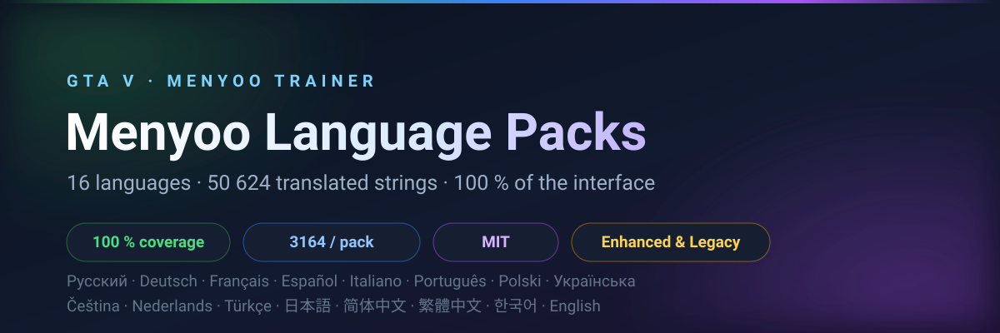

<p align="center"></p>

<div align="center">

# 🌍 Menyoo Language Packs — Čeština

**Český překlad rozhraní Menyoo — 3164 řetězců, 100 % pokrytí.**

[](#-pack) [](#-pack) [](LICENSE) [](#-installation)

[English](README.md) · [Русский](README.ru.md) · [Deutsch](README.de.md) · [Español](README.es.md) · [Français](README.fr.md) · [Italiano](README.it.md) · [Português](README.pt.md) · [Polski](README.pl.md) · [Українська](README.uk.md) · [Čeština](README.cs.md) · [Nederlands](README.nl.md) · [Türkçe](README.tr.md) · [日本語](README.ja.md) · [简体中文](README.zh.md) · [繁體中文](README.zh-TW.md) · [한국어](README.ko.md)

</div>

---

## 🚀 Instalace

```text
1. Language/Czech.json  ->  <GTA V>/menyooStuff/Language/
2. ve hře:  Settings → Language → Czech
3. ve hře:  Settings → Reload Language Files   (nebo hru restartuj)
```

Volitelně v `menyooStuff/menyooConfig.ini`: `language = Czech`

## 📦 Balíček

| Soubor | Klíčů | Pokrytí |
|:--|--:|--:|
| `Czech.json` | 3164 | 100 % |

Přeloženo je celé rozhraní (menu, přepínače hráče a vozidla, nastavení, počasí, hlášení). Názvy modelů, ID efektů FX a seznamy animací a cutscén zůstávají záměrně latinsky — jsou to identifikátory assetů, ne text UI.

## ✅ Kontrola

```bash
python tools/validate.py Czech
python tools/translate.py --pack Czech --target CS --backend google   # doplnění mezer
```

Úplná dokumentace (anglicky/rusky): [README.md](README.md) · [README.ru.md](README.ru.md)


## 🤝 Help your language

Fix one line in `Language/<Pack>.json` → [CONTRIBUTING.md](CONTRIBUTING.md) · credits: [TRANSLATORS.md](TRANSLATORS.md)

---
## 🏆 Autoři

Menyoo — MAFINS / itsjustcurtis · překlady a nástroje — MIT ([LICENSE](LICENSE)).

Opravy jsou vítané: změň hodnotu v JSON a otevři PR — CI ověří strukturu i markery.
