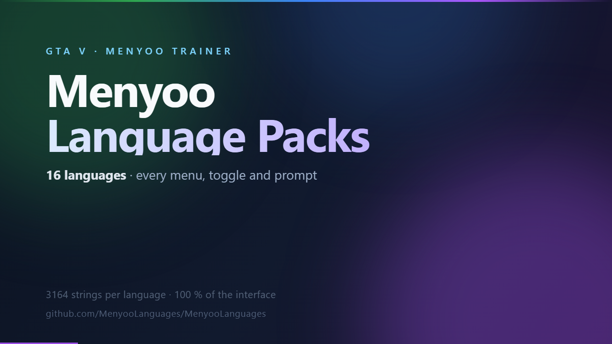

<p align="center"></p>

<div align="center">

# 🌍 Menyoo Language Packs

**16 языков · 50 624 переведённые строки · 100 % интерфейса**

[](#-покрытие)
[](#-покрытие)
[](#-покрытие)
[](LICENSE)
[](#-установка)
[](https://github.com/MenyooLanguages/MenyooLanguages/actions/workflows/validate.yml)
[](https://github.com/MenyooLanguages/MenyooLanguages/stargazers)

Перевод тренажёра [Menyoo](https://github.com/itsjustcurtis/MenyooSP) — каждая английская подпись меню на твоём языке.

[English](README.md) · **Русский** · [Deutsch](README.de.md) · [Español](README.es.md) · [Français](README.fr.md) · [Italiano](README.it.md) · [Português](README.pt.md) · [Polski](README.pl.md) · [Українська](README.uk.md) · [Čeština](README.cs.md) · [Nederlands](README.nl.md) · [Türkçe](README.tr.md) · [日本語](README.ja.md) · [简体中文](README.zh.md) · [繁體中文](README.zh-TW.md) · [한국어](README.ko.md)

</div>
<p align="center">
  <a href="assets/menyoo-language-packs-ad.mp4"></a>
  <br><sub>▶ обзор за 13 секунд — MP4, 1280×720, 1.3 МБ</sub>
</p>


---

## 🚀 Установка

```text
1. скопируй  Language/*.json  ->  <папка GTA V>/menyooStuff/Language/
2. в игре:  Settings → Language → нужный язык
3. в игре:  Settings → Reload Language Files     (или просто перезапусти игру)
```

### В один клик (Windows)

Скачай ZIP (**Code → Download ZIP**), оставь `install.bat` рядом с папкой `Language/`, запусти и перетащи в окно папку GTA V — инсталлятор скопирует все пакеты в `menyooStuff/Language/` и сохранит бэкап того, что перезапишет.

Можно зафиксировать язык в `menyooStuff/menyooConfig.ini`:

```ini
language = Russia
```

> Menyoo сам подхватывает все `*.json` из этой папки, поэтому **один файл = один новый язык**. Файлы в UTF-8 без BOM — парсер мода BOM не принимает.

---

## 📦 Покрытие

Эталон — **3164 ключа**: все английские подписи, которые рисует Menyoo 2.4.4, плюс названия языков в `Settings → Language`.

| | Пакет | Язык | Ключей | Покрытие |
|:--|:--|:--|--:|--:|
| 🇷🇺 | `Russia.json` | Русский | 3164 |  |
| 🇬🇧 | `English.json` | English (эталон для диффов) | 3164 |  |
| 🇫🇷 | `French.json` | Français | 3164 |  |
| 🇩🇪 | `German.json` | Deutsch | 3164 |  |
| 🇪🇸 | `Spanish.json` | Español | 3164 |  |
| 🇮🇹 | `Italian.json` | Italiano | 3164 |  |
| 🇧🇷 | `Portuguese.json` | Português (BR) | 3164 |  |
| 🇵🇱 | `Polish.json` | Polski | 3164 |  |
| 🇺🇦 | `Ukrainian.json` | Українська | 3164 |  |
| 🇨🇿 | `Czech.json` | Čeština | 3164 |  |
| 🇳🇱 | `Dutch.json` | Nederlands | 3164 |  |
| 🇹🇷 | `Turkish.json` | Türkçe | 3164 |  |
| 🇯🇵 | `Japanese.json` | 日本語 | 3164 |  |
| 🇨🇳 | `Chinese.json` | 简体中文 | 3164 |  |
| 🇹🇼 | `ChineseTraditional.json` | 繁體中文 | 3164 |  |
| 🇰🇷 | `Korean.json` | 한국어 | 3164 |  |

**Всего 50 624 строки.** `python tools/validate.py --strict` зелёный по каждому пакету.

Осознанно не переводятся: **названия моделей** транспорта/педов/объектов, **ID эффектов FX** (`Scr Sol1 Plane Wreck`), списки анимаций, катсцен и скриптов — это идентификаторы ассетов, а не текст интерфейса.

---

## 🧰 Инструменты

| Скрипт | Что делает |
|:--|:--|
| `tools/translate.py` | Догоняет любой пакет до 100 % выбранным движком. Никогда не перезаписывает готовые переводы, так что ручные правки живут вечно. Прогресс кэшируется в `tools/.cache/`. |
| `tools/validate.py` | Строгая проверка: JSON, BOM, неизвестные ключи, пустые значения, потерянные маркеры `~b~ ~s~ ~r~`, съеденные плейсхолдеры `%s`/`%d`, обрезанные пробелы по краям. `--strict` падает при любом пробеле в покрытии. |
| `tools/fix_edge_spaces.py` | Восстанавливает пробелы по краям: `"Введите ID: " + значение` не должно склеиваться в `"ID:12"`. |

```bash
python tools/validate.py              # таблица покрытия по всем пакетам
python tools/validate.py German       # один пакет
python tools/validate.py --strict     # режим для CI
python tools/fix_edge_spaces.py       # починить пробелы после машинного перевода
```

---

## ⚙️ Движки перевода

DeepL **не нужен**: он блокирует Беларусь, и пайплайн на него не завязан.

| Движок | Ключ | Откуда работает | Примечание |
|:--|:--|:--|:--|
| `google` *(по умолчанию)* | — | Беларусь, РФ, ЕС | публичный endpoint `translate.googleapis.com`, пакетная отправка по строкам |
| `yandex` | Api-Key + folder | Беларусь, РФ, КЗ | Yandex Cloud Translate, есть стартовый грант |
| `libre` | — | везде | свой LibreTranslate в docker, без лимитов |
| `argos` | — | везде, **офлайн** | нужен релизный Python (numpy не грузится на 3.12 *alpha*) |
| `mymemory` | — | везде | маленькая бесплатная квота, годится для тестов |
| `echo` | — | — | пересобирает английский эталон |

```bash
# всё сразу, без регистрации и ключей
python tools/translate.py --all --backend google

# один язык или тест на 50 строках
python tools/translate.py --pack German --target DE --backend google --limit 50

# Yandex Cloud
python tools/translate.py --all --backend yandex --key <API_KEY> --folder <FOLDER_ID>

# свой LibreTranslate
docker run -ti --rm -p 5000:5000 libretranslate/libretranslate
python tools/translate.py --all --backend libre --url http://localhost:5000

# полностью офлайн
pip install argostranslate
python tools/translate.py --all --backend argos
```

Что защищено внутри:

* маркеры `~b~ ~s~ ~r~ ~g~` и плейсхолдеры `%s %d %f` подменяются токенами до перевода и возвращаются после;
* если пакетный ответ вернул другое число строк, пачка добивается по одной;
* HTTP 429 повторяется с задержкой.

---

## 🗂 Структура

```text
Language/                  готовые пакеты, по 3164 ключа
data/langnames.txt         названия языков для Settings → Language
tools/translate.py         дозаполнение пакета до 100 %
tools/validate.py          строгая валидация
tools/fix_edge_spaces.py   починка пробелов по краям
assets/                    banner.svg + social-preview.png (1280x640)
install.bat                установка в один клик для Windows
CONTRIBUTING.md            как починить строку за 3 минуты
TRANSLATORS.md             таблица авторов переводов
tools/make_social_preview.py  перегенерация карточки через headless Chrome
assets/ad.html + tools/make_ad.py  видео-реклама, рендер через Chrome + ffmpeg
.github/workflows/         CI: валидатор и пробелы на каждый push
README.<lang>.md           документация на 16 языках
```

### Добавить язык

```bash
1. создать Language/<Name>.json        (можно {} )
2. добавить <Name> в data/langnames.txt
3. добавить "<Name>": "<код>" в PACKS внутри tools/translate.py   (не обязательно)
4. python tools/translate.py --pack <Name> --target <код> --backend google
5. python tools/validate.py <Name>
```

---

## ❓ Частые вопросы

<details>
<summary><b>Почему 3164 строки, а не «вообще всё»?</b></summary>

Menyoo 2.4.4 рисует ровно 3164 переводимых подписи — это весь интерфейс. Названия моделей, ID эффектов, списки анимаций и катсцен — идентификаторы ассетов: их перевод ничего не ломает, но выглядит мусором, поэтому они остаются латиницей. Добивать файл пустышками ради круглого числа на GitHub видно по ключам.
</details>

<details>
<summary><b>Вместо букв квадраты</b></summary>

Шрифты GTA V содержат EN, FR, IT, DE, ES, PT, PL, RU, JA, KO, ZH. Если игра запущена на английском, а пакет CJK — глифов может не быть: смени язык игры или `Settings → Menu Fonts → Обычный`. Языки, которых GTA V не локализует (арабский, хинди, тайский, иврит), специально не добавлены: шрифты игры их не отрисуют, а арабскому нужна ещё и RTL-склейка.
</details>

<details>
<summary><b>Насколько качественный перевод?</b></summary>

`Russia.json` — ручной, сверенный по меню (эталон). Каркас остальных пакетов (верхние меню, тумблеры игрока и транспорта, настройки, погода, кнопки) тоже ручной; оставшиеся ~3000 строк на язык добавлены машинным движком — структурно корректно, но без вычитки носителем. Правки приветствуются: меняешь значение в файле — `translate.py` его больше не тронет.
</details>

<details>
<summary><b>Работает на GTA V Enhanced?</b></summary>

Да. Пакеты читает сам Menyoo, от сборки игры это не зависит — Legacy и Enhanced используют одну папку `menyooStuff/Language/`.
</details>

<details>
<summary><b>Можно добавить свой язык?</b></summary>

Да, это один JSON-файл. Прогони валидатор и открывай PR: CI не пропустит битый JSON, потерянные маркеры и обрезанные пробелы.
</details>

---

## 🤝 Помочь проекту

| | |
|:--|:--|
| **Починить свой язык** | Поменяй одно значение в `Language/<Пакет>.json` и открой PR — 3 минуты, без кода: [CONTRIBUTING.md](CONTRIBUTING.md) |
| **Попасть в авторы** | Каждая принятая правка попадает в [TRANSLATORS.md](TRANSLATORS.md) |
| **Сообщить о кривой строке** | [форма «translation fix»](https://github.com/MenyooLanguages/MenyooLanguages/issues/new?template=translation-fix.yml) |
| **Попросить новый язык** | [запрос языка](https://github.com/MenyooLanguages/MenyooLanguages/issues/new?template=new-language.yml) |
| **Рассказать другим** | Пост в GTA-сообществе твоего языка даст больше, чем любой README |

---

## 🏆 Авторы и лицензия

* **Menyoo** — MAFINS / itsjustcurtis, действует лицензия мода.
* **Переводы и скрипты этого репозитория** — MIT, см. [LICENSE](LICENSE).
* Названия языков в `Settings → Language` берутся из имён файлов, а ключ `<Name>` внутри пакета пишется на самом языке (`Deutsch`, `日本語`, `한국어`).

<div align="center">

**Если пакет пригодился — ⭐ репозиторий и пришли правку для своего языка.**

</div>
